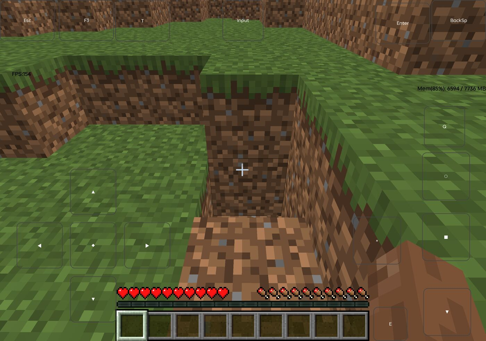
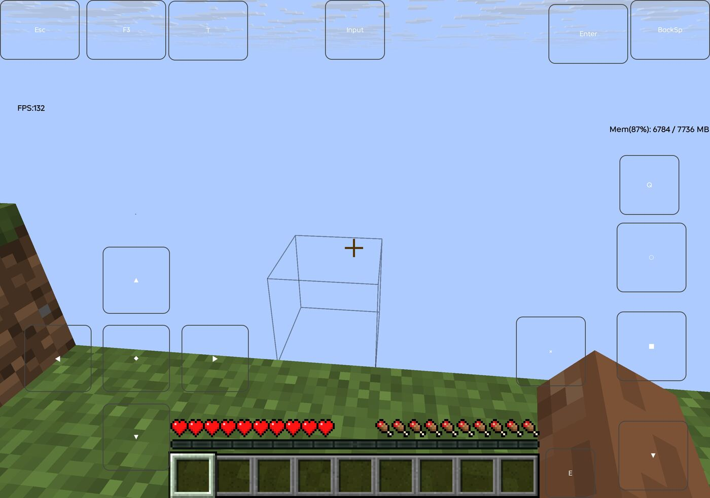
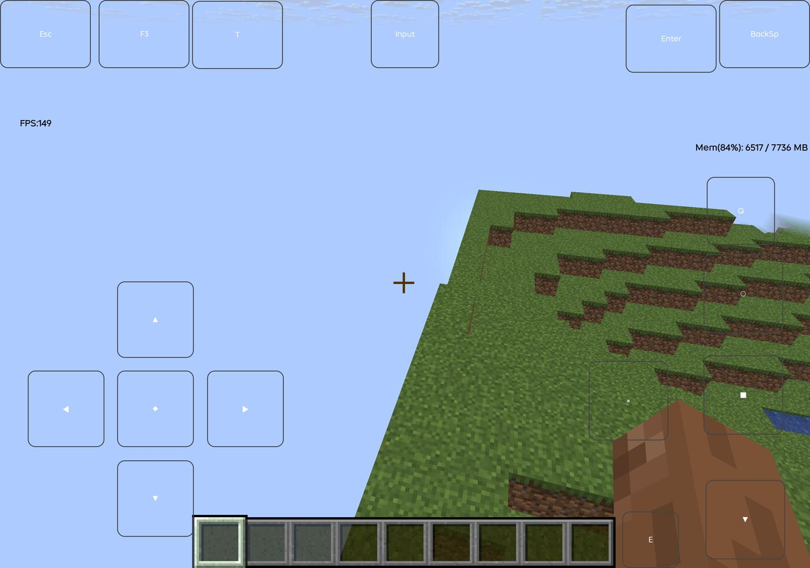

# ESP32-S3 Minecraft Server (N16R8 optimized build)


A playable Minecraft **Java Edition** server running on an **ESP32-S3 N16R8**
(16 MB flash + 8 MB PSRAM), with a **TCP management console** for remote
memory / CPU / temperature monitoring and player management over LAN.

<p align="center">
  
  
  
</p>

<p align="center"><sub>Running on a real ESP32-S3 N16R8 over 2.4 GHz WiFi · FPS 132–154 on the client side</sub></p>

> ⚠️ **Please read this first**
>
> This project was **heavily modified with the assistance of AI tools**, including
> code analysis, performance tuning, feature implementation and documentation.
> All changes are **not fully tested** and there are **many known and unknown bugs**
> — see [Known Issues](#known-issues).
> It is a **learning / demonstration project** and is not suitable as a production server.

---

## Origin

This is a **secondary derivative** of the following projects:

| Layer | Project | Notes |
|---|---|---|
| Original core | [p2r3/bareiron](https://github.com/p2r3/bareiron) | From-scratch Minecraft protocol server by p2r3 |
| Direct upstream | [jeyyprtf/esp32-mcserver](https://github.com/jeyyprtf/esp32-mcserver) | Packages bareiron for ESP32-S3 N16R8 with one-file config |

This project continues from **jeyyprtf/esp32-mcserver** and is released under
**GPL-3.0**, inherited from upstream.

**This is NOT an official release by the upstream authors.** Please do not
blame them for problems in this fork.

---

## What this fork adds / changes

### 1. Build fixes (making it actually run on N16R8)

| Problem | Fix |
|---|---|
| Application sources never compiled; linker could not find `app_main` | Renamed `src/` to `main/` — ESP-IDF only links `app_main` from a component named `main` |
| Build aborted on dozens of indentation warnings | Explicitly disabled `-Werror=misleading-indentation` etc. for the app component |
| Component submodules at wrong revisions; `mbedcrypto` target missing | Pinned every submodule to the commit recorded by the superproject |
| Log level too high to see boot output | Set to `INFO` |

### 2. Memory optimization (biggest win)

The original ran with only ~100 KB of internal SRAM free, dipping to **547 bytes**,
which silently broke block changes and item drops.

| Change | Effect |
|---|---|
| Moved `block_changes[]` (120 KB) to PSRAM via `EXT_RAM_BSS_ATTR` | Internal SRAM usage 73.8% → **35.9%** |
| Reduced WiFi buffers 16/64/64 → 8/16/16 | Freed ~25 KB |
| TCP window 32768 → 8192 | Per-connection cost 64 KB → 16 KB |
| `MAX_SOCKETS` 16 → 10 | Lower baseline overhead |

**Result: free internal SRAM 89 KB → 219 KB.**

### 3. Network latency optimization

Stock build had **185 ms average / 393 ms peak** LAN ping. Profiling showed the
cause was the firmware, not the network:

| Problem | Explanation | Fix |
|---|---|---|
| `vTaskDelay(1)` on every packet received | ≥1 ms at 1000 Hz; login involves dozens of round-trips | Replaced with `taskYIELD()` |
| `TCP_NODELAY` never set | Nagle's algorithm held small packets up to 40 ms | Set on listener and every client socket |
| Busy-wait `MSG_PEEK` polling | Burned CPU while idle | Added `select()` |
| `RX_BA_WIN=6` | Receive block-ack window too small | Raised to 8 |

**Result: 15.97 ms average ping, 4.93 ms jitter (~11× improvement).**

### 4. Chunk synchronization rewritten

The original logic drove chunk sending off player movement deltas, with three flaws:

- `if (dx == 0 && dz == 0) break;` — **no chunks at all** while standing still
- `VISITED_HISTORY = 4` — returning to an old position was treated as "already visited"
  and **never re-sent**, leaving the client looking at void
- Sending all chunks at once blocked the main loop for seconds

**Replaced with:** a per-player `(2r+1)²` chunk bitmap, topping up missing chunks
each frame within a 30 ms budget.

### 5. Main-loop starvation fix (critical)

The original main loop did this:

```c
client_index++;
if (clients[client_index] == -1) continue;   // <-- jumps over everything below
// ... console commands, chunk sync, server tick, packet handling
```

With a single player occupying one of 16 slots, **~94% of loop iterations did
nothing at all**. That single line caused a surprising number of symptoms:

| Symptom | Cause |
|---|---|
| Client took ~30 s to notice the board was powered off | keep-alive was sent only ~1/16th as often as intended |
| Fall damage never applied | damage is evaluated inside `handleServerTick()` |
| Breaking blocks gave no items | item grant was starved by the same slowdown |
| In-game commands appeared to do nothing | chat handling timed out client-side |

**Fixed** by moving the server tick, queued console commands and chunk sync
*before* the `continue`, so they run every iteration.

### 6. TCP management console (new)

**Port 25566.** No serial adapter needed.

```
$ nc <board-ip> 25566
{"uptime_ms":123456,"heap_free":180000,"psram_free":7000000,
 "cpu_core0":12,"cpu_core1":8,"temp_c":52.3,"players":1}
```

Send a line of text to run a command:

| Command | Description |
|---|---|---|
| `list` | Online players (slot, name, coords, health) |
| `players` | Detailed info (gamemode, health, food, position) |
| `kick <name\|slot>` | Disconnect a player |
| `say <text>` | Broadcast a chat message |
| `gm <0\|1\|2\|3>` | Game mode (0 survival / 1 creative / 2 adventure / 3 spectator) |
| `give <player> <itemID> [n]` | Give items (1-64) |
| `tp <player> <x> <y> <z>` | Teleport one player |
| `tpall <x> <y> <z>` | Teleport everyone |
| `heal <player>` | Restore health and hunger |
| `kill <player>` | Kill a player |
| `clear <player>` | Empty a player's inventory |
| `time <day\|noon\|night\|midnight\|0-23999>` | Set world time |
| `setblock <x> <y> <z> <blockID>` | Place a single block |
| `fill <x1 y1 z1> <x2 y2 z2> <blockID>` | Fill a region (max 4096 blocks) |
| `spawn <mobID> [n]` | Spawn mobs (25 chicken / 28 cow / 95 pig / 106 sheep / 145 zombie) |
| `save` | Flush world and player data to flash |
| `status` | Multi-line status report |
| `help` | Command list |

> **Not available** (these systems do not exist in this server):
> `xp`, `enchant`, `effect`, `execute`, `gamerule`, `datapack`,
> dimension switching (no Nether/End).

#### Bundled client

`mc_console.py` is included:

```bash
python3 mc_console.py status --host 192.168.1.100   # one-shot status
python3 mc_console.py watch  --host 192.168.1.100   # refresh every 2s
python3 mc_console.py list                          # online players
python3 mc_console.py kick Steve                    # kick
python3 mc_console.py say Server restarting in 5m   # broadcast
```

**Design note:** console commands never write to player sockets directly —
that races with the main loop and previously kicked players offline.
Commands that touch sockets only set a flag; the main loop performs the write,
guaranteeing serialized access.

---

### 7. Web-based WiFi provisioning (new)

No more hardcoding SSID/password. On first boot, or whenever the saved
network cannot be reached, the board opens a setup hotspot:

| | |
|---|---|
| **Hotspot SSID** | `esp32_ap_ssid` |
| **Hotspot password** | `esp32_ap_pwd` |
| **Setup page** | **http://192.168.4.1** |

Connect to the hotspot, open the page, pick your WiFi from the scanned list,
enter the password and submit. Credentials are stored in NVS and reused
on the next boot.

**Behaviour**

- Credentials saved and reachable -> connects directly, starts the server
- No credentials / connection fails -> opens the setup hotspot
- Provisioning succeeds -> hotspot, HTTP and DNS shut down automatically,
  the MC server and management console start only after an IP is obtained
- Portal startup fails 3 times -> stops retrying instead of looping

> The MC server and TCP console are **not** started while in provisioning
> mode, so the whole socket pool and CPU are available to the setup page.

Based on the open-source [lz00qs/esp_wifi_portal](https://github.com/lz00qs/esp_wifi_portal)
component (Apache-2.0), with several fixes applied — see `Known Issues` below.

## Known Issues

> These problems **still exist** in this build. Contributions welcome.

1. **Blocks may render as transparent**
   Likely caused by the protocol stream desyncing under concurrent socket
   access (the server used to write to player sockets from multiple tasks).
   That has since been serialized through the main loop, which reduced the
   frequency a lot, but **the root cause is not fully proven**. A diagnostic
   unit test (`tests/test_mc_logic.c`) confirms the chunk packet length math
   is self-consistent — so the remaining fault is elsewhere.

2. **No Nether or End dimensions**
   Only block ID constants exist (`B_netherrack` etc.); there is **no dimension
   switching logic**. The game is therefore **impossible to finish** — no blaze
   rods, no End, no dragon.

3. **Only 5 mob types**
   Chicken, cow, pig, sheep, zombie. No creeper, enderman, skeleton, etc.

4. **No enchanting / brewing / redstone**
   Those blocks exist as IDs only, with no behavior.

5. **TNT cannot be ignited**
   TNT is a decorative block. No explosion, chain reaction or damage.

6. **No structures** (fortresses, villages, etc.)

7. **No authentication**
   Any username may join. **Never expose this to the internet** — LAN only.

8. **Fragile save compatibility**
   Changing `MAX_BLOCK_CHANGES` makes existing `world.bin` unreadable;
   the flash partition must be erased.

9. **High CPU usage**
   Even after raising the `select()` timeout and enabling run-time stats,
   CPU core 1 may sit near 100%.

---

## Requirements

**Hardware**
- **ESP32-S3 N16R8** (16 MB flash + 8 MB *Octal* PSRAM). Other variants may
  fail to boot due to insufficient memory.
- USB **data** cable
- **2.4 GHz** WiFi (ESP32 cannot use 5 GHz)

**Client**
- Minecraft **Java Edition 1.21.8** (protocol 772). Other versions will not connect.
- Bedrock Edition (mobile / console) is **not** supported.

---

## Building

Requires **ESP-IDF v5.4** (developed against v5.4.4).

```bash
# 1. Generate registries (needs Java 21+ and Node.js, once only)
mkdir -p notchian
# place the 1.21.8 server.jar into notchian/
./extract_registries.sh

# 2. Build
idf.py set-target esp32s3
idf.py build
```

> WiFi credentials are configured at runtime through the web portal, so no
> editing is required before building. `include/config.h` only holds
> gameplay settings (view distance, max players, etc.).

> Submodules must be pinned to the revisions recorded by the superproject,
> otherwise the build fails with `mbedcrypto not built`.

## Flashing

```bash
esptool.py --chip esp32s3 -p /dev/ttyACM0 write_flash 0x0 build/esp32-mcserver.bin
```

Or build a single merged image (bootloader + partition table + app):

```bash
esptool.py --chip esp32s3 merge_bin -o full.bin \
  --flash_mode dio --flash_freq 80m --flash_size 16MB \
  0x0 build/bootloader/bootloader.bin \
  0x8000 build/partition_table/partition-table.bin \
  0x10000 build/esp32-mcserver.bin

esptool.py --chip esp32s3 -p /dev/ttyACM0 write_flash 0x0 full.bin
```

> **Flash mode must be DIO.** Some N16R8 boards are wired for two-line SPI;
> using QIO makes the bootloader fail to read flash and loop on the RTC watchdog.

## Usage

### 1. Configure WiFi (first boot)

1. Power up the board. Serial console (115200) will show it is starting the portal.
2. On your phone, connect to hotspot **`esp32_ap_ssid`** (password `esp32_ap_pwd`).
3. Open **http://192.168.4.1** — a page appears listing nearby WiFi networks.
4. Pick your 2.4 GHz network, enter the password, tap **Connect**.
5. The board saves the credentials, joins your network, and closes the hotspot.

> If the WiFi can't be reached later, the hotspot automatically comes back so
> you can reconfigure without re-flashing.

### 2. Join the game

Watch the serial console for the assigned IP:

```
Got IP: 192.168.1.xxx, starting server...
Server listening on port 25565...
```

On the client, connect to the same 2.4 GHz network, add a server with that IP.

### 3. First join

The first join takes several seconds while chunks are generated.

### In-game commands

| Command | Description |
|---|---|
| `!gm 0~3` | Change game mode |
| `!tp <x> <y> <z>` | Teleport |
| `!give <item>` | Give item |
| `!time` | Set time |
| `!help` | List all commands |

---

### Fixes applied to the WiFi portal component

The upstream `esp_wifi_portal` component needed several fixes to work reliably
on this board. All are marked with `[patch]` comments in the source:

| Symptom | Cause | Fix |
|---|---|---|
| Hangs, neither connects nor opens hotspot | `esp_wifi_connect()` returns `ESP_ERR_WIFI_SSID` with no event when no credentials are saved | check NVS first, open portal immediately |
| Reboot loop at boot | `nvs_flash_init()` return value ignored | erase-and-retry on `NO_FREE_PAGES` / `NEW_VERSION` |
| `abort()` when opening hotspot | WPA3 SAE was disabled in sdkconfig | re-enabled |
| Hotspot opens but setup page dead | portal started inside the small esp_event task (2304 B stack) | moved to a dedicated 8 KB task |
| Page unreachable | client got IP `8.8.8.8` from "enhanced captive portal" | switched to standard `192.168.4.1` DHCP |
| `Header fields are too long` | `HTTPD_MAX_REQ_HDR_LEN` default 512 B | raised to 2048 B |
| Page still broken after failures | `is_webserver_started` set even when start failed | return the real error |
| Out-of-memory over time | a new 8 KB task created on every disconnect | `portal_task_pending` guard + give up after 3 failures |
| Possible crash on success | event group deleted while another task waits on it | clear bits instead of deleting |

---

## Tests

Pure-logic regression tests run on your PC — no hardware needed:

```bash
cd tests && ./run_tests.sh
```

Covers chunk packet sizing, VarInt encoding, block drop tables,
item stacking/overflow, inventory slot allocation, and chunk bitmap math.

## Layout

```
├── main/              Application code (ESP-IDF requires the name "main")
│   ├── main.c         Main loop, networking, chunk sync
│   ├── monitor.c      TCP management console (added by this fork)
│   ├── packets.c      Protocol encode/decode
│   ├── procedures.c   Game logic
│   ├── worldgen.c     Terrain generation
│   └── serialize.c    Save/load
├── components/
│   └── esp_wifi_portal/   Web WiFi provisioning (3rd-party, patched)
├── include/
│   ├── config.h         Gameplay settings (no credentials needed)
│   ├── config.h.example Configuration reference
│   └── globals.h        Global definitions
├── tests/
│   ├── test_mc_logic.c  Pure-logic regression tests (runs on PC)
│   └── run_tests.sh
├── mc_console.py      Local console client
├── partitions.csv     Partition table
└── sdkconfig.defaults Default build configuration
```

---

## License

**GPL-3.0**, inherited from upstream.

Copyright of the original work belongs to p2r3 (bareiron) and jeyyprtf
(esp32-mcserver). Modifications in this fork are released under the same license.

---

## Credits

- [p2r3/bareiron](https://github.com/p2r3/bareiron) — from-scratch Minecraft protocol core
- [jeyyprtf/esp32-mcserver](https://github.com/jeyyprtf/esp32-mcserver) — packaging and build guide
- Espressif — ESP-IDF and hardware support

---

**Reminder: this project was modified with AI assistance and contains many
unfixed issues. Use it for learning and experimentation only.**
